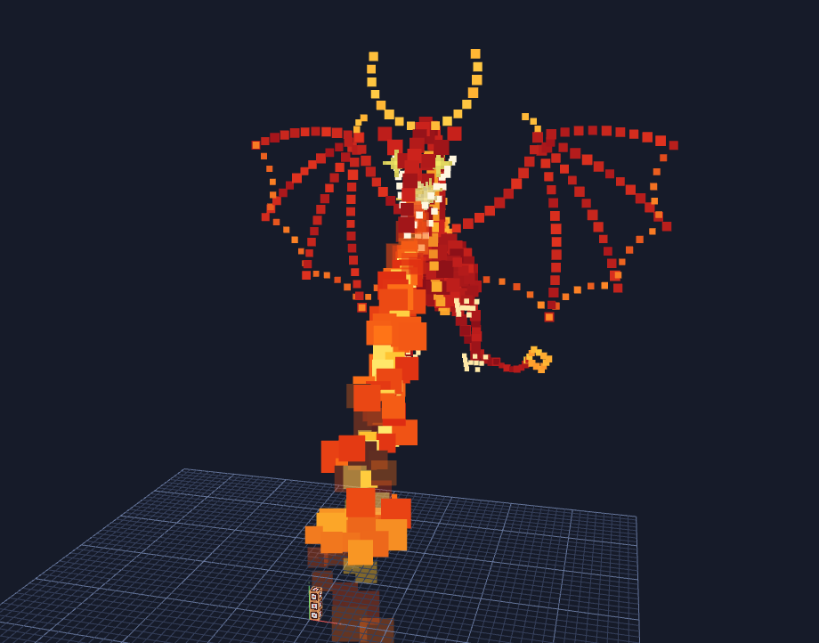

# Bloxd Particle Studio

Build particle pictures for [Bloxd](https://bloxd.io) in a 3D view, then export
the code for a code block. Place single particles or ready-made shapes made of
many particles, pick a texture and a colour, and paste the result into your
world. A timeline sets when each of them appears, where it moves and when it
goes away. Groups move many objects as one, ready-made moves such as Flap, Spin
and Orbit do the animating for you, and three examples show what is possible.


This is an unofficial fan tool. It is not made, approved or supported by Bloxd.

## Open it

Pick whichever is easiest:

- **Use it online:** <https://epicoo00000.github.io/Bloxd-Particle-studio/>
- **Double-click `START-HERE.html`.** It is the whole studio in one file and
  works offline.
- **Run it locally:** `npm start`, then open <http://localhost:8080>.
- **Host your own copy:** upload the folder to any static host. `index.html` is
  the start page. On GitHub Pages, choose "Deploy from a branch", `main` and
  `/ (root)`, and leave "Custom domain" empty.

It needs a current browser with WebGL 2, which all current desktop browsers
have. It was tested in Chromium, the engine of Chrome and Edge.

## Make something

1. Press **+ Add** and pick a single particle or one of the 224 shapes. Pick a
   tab, or type in the search box. Or start from one of the
   [Examples](#examples) at the top.
2. **Click** it in the 3D view. Drag the arrows to move it. Switch to Rotate or
   Resize in the top bar.
3. Press **Settings** to style it: texture, colour, size, how many particles.
4. Press **Timeline** to make it appear later, move or go away sooner. See
   [Timing](#timing).
5. Press **Play** to see what happens after the click.
6. Press **Export code**.

The crate in the middle is your code block. One grid square is one block, and
everything shows up in the game where you see it around the crate.

**The 3D view has the whole window.** The rest of the studio is shut until you
ask for it. Four coloured buttons in the corners of the 3D view open and close
its parts, and the 3D view makes room for what is open:

| Button | Colour | Opens | Key |
|---|---|---|---|
| **+ Add** | green | Single particle and the shapes, on the left | 1 |
| **Scene** | yellow | The list of everything in the scene, on the left | 2 |
| **Settings** | purple | The settings of what is selected, on the right | 3 |
| **Timeline** | red | When things appear and how they move, at the bottom | 4 |

Press a button again to close its part. A button stands out while its part is
shut and looks pressed in, dark with a rim in its colour, while it is open. The
studio remembers which parts you keep open. Nothing opens by itself: clicking
an object selects it, and Settings shows it when you open that.

**Categories.** The settings on the right are sorted into categories: Look,
Shape, Place, Time and repeat, Keys, Ready-made moves, Motion, Group and
mirror. Click the name of a category to open or close it. A closed one still
says in a few words what is in it, and the studio remembers which ones you keep
open. Add and Scene share the height of the left panel when both are open,
and the scene list scrolls by itself.

Your scene is kept in the browser between visits. **Save** writes it to a file
and **Open** loads one, so you can keep several scenes or share them.

### Shapes

There are 224 shapes in nine tabs. Click a tab to see its shapes, or type in
the search box above the tabs to look through all of them: a name ("star",
"heart"), a letter, a number or a sign ("A", "7", "?"). Enter adds the first
shape found.

| Tab | How many | Shapes |
|---|---|---|
| Basic | 34 | Line, Circle, Disc, Arc, Square, Filled square, Triangle, Polygon, Star, Heart, Plus, Rays, Spiral, Wave, Rectangle, Rounded square, Diamond, Oval, Half circle, Pie slice, Double circle, Target, Right triangle, Double square, Zigzag, Square wave, Square spiral, Pill, Plus outline, Net, Filled polygon, Filled star, Filled heart, Filled ring |
| 3D | 31 | Sphere, Dome, Cube, Filled cube, Cylinder, Cone, Pyramid, Donut, Helix, Tornado, Tetrahedron, Octahedron, Dodecahedron, Icosahedron, Football, Prism, Crystal, Gem, 3D star, Cube in a cube, Step pyramid, Hut, Star block, Globe, Ring ball, Filled ball, Capsule, Hourglass, Vase, Goblet, Flying saucer |
| Letters | 26 | A to Z |
| Numbers | 20 | 0 to 9, and the signs ! ? # @ & % $ € = ÷ |
| Symbols | 25 | Arrow, Double arrow, Turn arrow, Chevrons, Tick, X mark, No sign, Peace sign, Yin yang, Smiley, Sad face, Skull, Lightning, Music note, Double note, Infinity, Spade, Club, Pentagram, Hexagram, Crosshair, Warning sign, Atom, Eye, Speech bubble |
| Nature | 25 | Sun, Moon, Cloud, Drop, Snowflake, Flame, Leaf, Tree, Pine tree, Flower, Tulip, Clover, Mushroom, Cactus, Mountains, Rainbow, Fish, Bird, Butterfly, Cat, Paw print, Rabbit, Spider web, Bat, Planet |
| Things | 25 | House, Castle, Key, Padlock, Sword, Shield, Crown, Flag, Bell, Gift, Balloon, Trophy, Jewel, Rocket, Sailing boat, Anchor, Umbrella, Light bulb, Candle, Potion, Pickaxe, Hammer, Bow and arrow, Apple, Ghost |
| Curves | 17 | Rose, Lissajous, Spirograph, Petal ring, Wavy circle, Shell spiral, Spiral arms, Bounce path, Trefoil, Torus knot, Globe spiral, Ball seam, DNA, Twin helix, Slinky, Spring ring, Möbius strip |
| Effects | 21 | Smoke, Firework, Fountain, Galaxy, Whirlpool, Portal, Halo, Ripple, Cyclone, Orbit rings, Scatter, 3D flame, Comet, Light pillar, Cage, Crown ring, Wave ring, Light cone, Spiral stairs, Puffy heart, Orbs |

Every shape has a "How many" slider for the number of particles. 72 of them
have settings of their own, such as the points of a star, the petals of a
flower or the turns of a helix.

To write a word, add its letters one after the other. Each new shape takes the
next free place in a row, so the letters line up by themselves.

### Timing

The timeline (press **Timeline**, at the bottom right of the 3D view) shows
time from left to right, in seconds after the click on the code block. Every
object and every group has a row. Its bar starts when the object appears and
ends when it is gone.

| To | Do this |
|---|---|
| Make an object appear later | Drag its bar to the right. Or type the seconds in "Appears" on the right. |
| Make it stay longer or shorter | Drag the right end of its bar. Or change "Lifetime". |
| Make it fade in or out | Tick "fade in" or "fade out" under "Time and repeat". |
| Look at one moment | Click on the row of numbers above the bars. The red line is the time marker. |
| See everything happen | Press Play. Escape goes back to the start. Tick Loop to see it again and again. |

**Make an object move**

1. Click the object.
2. Click on the row of numbers at the time it should arrive somewhere, for
   example at 2.
3. Press **+ Add key**. A yellow diamond appears in the row of the object.
4. Move, rotate or resize the object. This is where it will be at that time.
5. Press **Play**. The object travels from where it starts to the key.

Groups get keys the same way. Add more keys for more stops, up to 12 for one
object. "Gets there" sets how
the object travels to the key under the time marker: Smooth, Steady, Speed up,
Slow down or Jump.

What a change of place does depends on where the time marker is:

- on a diamond, it changes that key;
- at the start of the bar, it changes where the object starts;
- between two diamonds, it makes a new key there.

Drag a diamond to give a key another time. To remove a key, click its diamond
and press Delete, or press **Delete key**.

With the time marker at 0 the studio shows every object where it starts, so
that you can build. At any other time it shows that moment, and objects that
are not there at that time are see-through.

An object turns the short way round from one key to the next. For full turns,
tick "by the angles as typed" under Keys and type the angle in the Rotation of
a key, for example 360.

After its last key an object stays where it is until its bar ends. If it has
Motion settings (Move, Scatter, Grow, Gravity), they start after the last key.
From then on it no longer follows its group: it is let go where the group is at
that moment.

### Groups

A group holds objects, and other groups. Move, turn or resize the group and
everything in it comes along. Give the group keys and they all move together:
a wing made of ten bones flaps as one thing.

| To | Do this |
|---|---|
| Select several objects | Ctrl+click them, in the 3D view or in the Scene list. Shift+click in the list takes everything in between. |
| Make a group | Select the objects and press **Group** above the Scene list, or Ctrl+G. |
| Put something into a group later | Drag it onto the group in the Scene list. Or choose the group under "Group and mirror". |
| Take it out again | Drag it to "Drop here" below the list, or choose "(no group)". |
| Take a group apart | Select it and press **Ungroup**. What was in it stays where it is. |
| Tidy the lists | Click the little arrow of a group to close it. Its rows go away in the Scene list and on the timeline. |

Nothing moves when you group, ungroup or drag things between groups: every
object stays where it is at the start, and starts at the moment it did.

In the 3D view a click on something in a group selects the group. Click again
to get the thing itself. A closed group opens when something in it is selected,
so what you work on always has its row in the list.

**The pivot.** A group turns about one point and is resized from it: its pivot.
It is where the arrows are. A new group has it in its middle. To put it
somewhere else, for example at the shoulder of a wing, open Place, tick "Move
only the pivot", drag the arrows there and untick it again.

The Position of something in a group counts from the pivot of the group, and
"Appears" counts from the moment the group starts.

### Mirror copies

Under "Group and mirror", **Mirror copy** makes a twin on the other side: X for
left and right, Y for up and down, Z for front and back. The twin has the same
keys, mirrored, so it moves like a mirror image. A "Left wing" is named "Right
wing".

The mirror stands in the pivot of the group the object is in. Build one wing
inside the group of the body and its twin lands on the other side of the body.
Outside a group the mirror stands in the middle of the code block, and Y turns
the copy upside down where it is.

### Repeat

Under "Time and repeat", **Repeat** plays an object again and again: type how
many times and how many seconds lie between two plays. "Back to back" starts
each play when the one before it ends. The later plays show as thin bars on the
timeline.

A group repeats with everything in it. Things that fly off by themselves (see
Motion) are let go again in every play: that makes fire, smoke, rain and
fountains.

Every play makes its particles again, so 10 plays cost 10 times the particles.
The category says how many that is.

### Ready-made moves

Open "Ready-made moves", pick one, set how long one go takes and how often, and
press **Apply**. The studio works out the keys.

| Move | What it does |
|---|---|
| Flap | Swings out and back, like a wing. A group swings about its pivot. |
| Pulse | Grows and shrinks back. |
| Spin | Turns round and round at a steady pace. |
| Orbit | Circles around a point next to it. This puts the object into a group that turns; move the pivot of that group to move the middle of the circle. |
| Shake | Trembles on the spot. |
| Bounce | Jumps up and falls back. |
| Float | Drifts gently up and down. |
| Rise and fade | Drifts up and fades away. With Repeat it keeps coming, like smoke. |

A move starts from where the object is at the time marker and replaces what it
did after that moment. So you can put the marker at 3 seconds and add a Bounce
after a move you made by hand. The keys are ordinary keys: change them
afterwards as you like.

An object can have 12 keys. The category says how often a move fits. For more,
use Repeat.

### Colour and size at a key

A key can also change the look. Click a diamond on the timeline, open Keys and
tick "changes here" next to Colour or Size. The object then turns to that
colour on its way to the key, and has that particle size when it gets there.
A key without a tick keeps the look of the key before it.

The colour changes smoothly. A particle keeps its size all its life in the
game, so a change of size is shown in a few steps.

### Copy keys, and stretch time

**Copy keys** (under Keys) remembers what an object does. Select another
object and press **Paste keys**: it makes the same moves, turns and changes of
size, but from where it is. The keys go in at the time marker.

To make something slower or faster, type another number in **Lasts** under
"Time and repeat". Everything it does is stretched to fit, and a group
stretches all that is in it. With nothing selected, "Whole show" on the right
does the same for the whole scene. Keys cannot come closer than 0.1 seconds,
so a stretch stops there.

### Examples



The **Examples** button at the top opens finished scenes to play and to take
apart. Undo brings your own scene back.

- **Dragon.** A dragon 76 blocks wide glides towards the code block with its
  wings spread, throws its head back, opens its jaws and breathes fire at the
  ground in front of the block. It lasts 10 seconds. It is made of 76 ordinary
  objects in 8 folders (groups that do nothing but keep the list short): arcs
  for the neck, the tail and the wing bones, zigzags for the teeth, claws and
  spikes, a ball of rings for the body and smoke clouds for the fire. Select
  the folder "Dragon" to move or resize the whole animal. The export is 1,211
  particles in 3 stacked code blocks. That is twice what the studio calls a
  lot, so it can lag on slower devices. The dragon appears 70 blocks from the
  code block and 30 blocks up, on the side where Z grows.
- **Campfire (313 particles, 4.7 seconds, one code block).** Flames rise from
  the top of the code block, turn from yellow to red and shrink; sparks and
  smoke fly off. It shows Repeat and keys that set colour and size. Everything
  in it ends after the same 4.7 seconds. World Code starts a scene again when
  it is over, so exported as World Code the fire burns on and on.
- **Portal (311 particles, 6.2 seconds, one code block).** A ring that pulses
  between two pillars, two sparks that circle it and dust that is pulled in.
  It shows groups, a mirror copy (the right pillar and the left spark) and the
  moves Pulse and Orbit.

`examples/build.mjs` is the script that wrote them, and `examples/dragon.mjs`
the one for the dragon. Change the numbers at the top and run
`node examples/build.mjs`. `examples/dragon.json` is the dragon as a scene file
for **Open**.

### Keyboard and mouse

| Key | Does |
|---|---|
| W, E, R | Move, Rotate, Resize |
| Ctrl+click | Select several. Shift+click in the lists: everything in between |
| Ctrl+A | Select everything |
| Ctrl+G, Ctrl+Shift+G | Group what is selected, take the group apart |
| Ctrl+D | Duplicate, with all that is in it |
| Delete or Backspace | Delete what is selected, or the key whose diamond was clicked last |
| Ctrl+Z, Ctrl+Shift+Z (or Ctrl+Y) | Undo, Redo |
| F | Center the view |
| Space | Play or pause |
| K | Add a key at the time marker |
| Left, Right | Move the time marker by 0.05 seconds, with Shift by 1 second |
| Escape or Home | Back to the start. Escape also deselects and closes the export window |
| 1, 2, 3, 4 | Open or close Add, Scene, Settings, Timeline |

Mouse: drag to look around, right-drag to slide, wheel to zoom.

## Put it in your world

1. In Bloxd, place a **Code Block** (search for it in the creative menu).
2. Right-click it, paste the exported code and close the editor.
3. Click the block. The particles appear around it.

Everything then happens as on the timeline: objects appear, move and vanish.
Click again to start it again.

**Big scenes.** A code block holds 16,000 characters and 500 lines. When a
scene needs more, the studio splits the code into several parts and shows a tab
for each. Stack that many code blocks on top of each other and paste part 1
into the bottom block, part 2 into the next one up, and so on. Code blocks that
touch run together, so click one in the middle of the stack. If part of the
scene is missing, click the other blocks too.

**World Code.** Choose "World Code" in the export window to get a version that
redraws the scene on a timer instead of waiting for a click. Type the world
position where the studio's crate should be, then paste the code into World
Code (F8). If your World Code already has a `tick` callback, merge the two by
hand, because a world can only have one.

**Export options**

| Option | Meaning |
|---|---|
| Positions | How finely positions are stored. 0.01 block is exact. 0.05 and 0.1 give shorter code. |
| Hide beyond | Players further away than this many blocks do not see the particles. 0 means always shown. |

## What the settings mean

| Setting | Meaning |
|---|---|
| Texture | One of the 13 particle pictures the game offers. |
| Colour | Tints the picture. "Second colour" gives every particle a random mix of the two. |
| Size | Particle size in blocks. "Sizes up to" makes them vary. |
| Appears | Seconds after the click until the object shows up. The same as dragging its bar on the timeline. |
| Lifetime | How long the particles stay. The studio shows the time in seconds. An object with keys stays at least until its last key. |
| Fade in | The particles get visible over the first fifth of the time the object is there. |
| Fade out | The particles fade away over the last fifth of that time. |
| Blend | How particles mix with what is behind them. Normal is the usual choice. Glow adds light. |
| Move | Speed along X, Y and Z. With Move Y = 1 and Lifetime 6, the particles rise 6 blocks before they vanish. |
| Scatter | Adds a random extra speed to each particle, in any direction. |
| Grow | Shapes only. Particles fly away from the middle of the shape, or towards it below 0. |
| Gravity | Below 0 the particles fall, above 0 they float up, faster and faster. |
| Turning | Objects with keys only. Unticked, the object turns the short way round to the next key. Ticked, it turns by the Rotation numbers as typed, so 360 is a full turn. |
| Repeat, Every | How many times it is played, and the seconds from one play to the next. |
| Lasts | Seconds one play takes. Type another number to stretch everything it does. |
| In group | The group it belongs to. Its Position then counts from the pivot of that group. |
| Move only the pivot | Groups only. While ticked, moving the group moves the point it turns about and leaves what is in it where it is. |

## Good to know

- **Not tested inside Bloxd.** The exported code is checked by automated tests
  against the documented API and against how the game's own code reads its
  options. It has not been run in the game from here. If something looks
  different in your world, the game is right and the studio is wrong.
- **The preview is an estimate.** Timing, movement and blend modes are copied
  from how the game's code works, not measured in the game. In particular, the
  seconds shown for a lifetime assume the game's usual particle speed.
- **Many particles cost speed.** The code makes one particle effect per
  particle. A few hundred is a sensible size. The studio warns above 600, and
  very large scenes may lag or be cut short by the game's limit on how long a
  script may run.
- **Timing was not tried in the game either.** Bloxd code cannot wait. So the
  studio gives every particle its whole plan at the click: when to show up,
  where to fly and when to go. It writes that plan with options the game
  documents (`colorGradients`, `velocityGradients`) and the tests play it in a
  copy of the particle engine, but it has not run in Bloxd. Try a small timed
  scene in your world first. Scenes without timing export exactly the code
  they did before the timeline existed. Groups that move, repeats and colours
  at keys are written with the same options, and have not run in Bloxd either.
- **Keys cost particles.** A particle can only fly along a straight line. So
  every stretch between two keys gets particles of its own, and a turn gets
  several sets of them. An object with three keys needs about four times its
  particles. The counter at the top and the Keys box on the right show the
  real number.
- **Big, quick turns.** A turn is flown as short straight stretches. A large
  shape that turns far in a short time can look angular, and the Keys box then
  says so. Give the turn more time or add a key halfway.
- **Groups that move cost particles too.** What is in a group that turns flies
  the same kind of short straight stretches: from 8 for a full turn on a small
  circle to about 20 on a big one. So one round of Orbit or Spin makes that
  many particles for every point. Far from the pivot the path may be off by up
  to 1% of that distance. A group that only slides at a steady pace is cheap.
- **Repeats cost particles and code.** Every play is written out in the code.
  A scene with many plays can need more than one code block.
- **Colours that change.** A piece that changes colour while it is seen is
  switched on over 75 milliseconds. On a device that draws fewer than 20
  frames a second, a point can be faint for one frame at such a moment.
- **Mirror copies and stretched groups.** A mirror copy has one size the other
  way round (a negative Stretch). That is intended. Taking apart a group that
  is stretched more along one side than another, with turned things in it, can
  bend them slightly: a shape can be turned and stretched, but not slanted.
- **A flash with Glow.** At a key, two sets of particles can show at once for
  a frame or two. With a Glow blend that moment is brighter.
- **Long waits.** An object that appears after 30 seconds is made at the click
  and waits unseen. Whether the game keeps unseen particles that long, for
  example when the player walks away, is not known.
- **Stacked code blocks.** The game's documentation says touching code blocks
  run together but not how far that reaches along a stack, so a tall stack may
  need more than one click.
- **One preview picture is a stand-in.** The real picture for
  `fishingFishSilhouette` could not be obtained, so the studio shows its own
  drawing of a fish, marked `~`. The game still shows the real one. See
  [textures/README.md](textures/README.md).

## For developers

No build step is needed to run it: plain HTML, CSS and ES modules, with
three.js included in `vendor/`.

```
npm start        # serve the folder on http://localhost:8080
npm test         # unit tests
npm install      # once, before the next command
npm run build    # rebuild START-HERE.html
```

`START-HERE.html` is built from the other files. After changing anything in
`index.html`, `js/`, `css/`, `vendor/` or `textures/`, run `npm run build`;
`npm test` fails while the file is out of date. After changing an example, run
`node examples/build.mjs` first.

A scene is a flat list of objects. A group is an entry with the shape `group`,
and what is in it names the group as its `parent`. `sceneTree()` in
`js/scene.js` answers who is in what and when everything happens.

| Path | What it is |
|---|---|
| `index.html`, `css/style.css` | The page and its looks |
| `js/shapes.js` | The shape library: the first 24 shapes, the tabs and the search. Each shape returns a list of points |
| `js/shape-kit.js` | The geometry tools the shapes are built from, and the small drawing language used for letters and pictures |
| `js/shapes-geo.js` | Shapes made from formulas: more basic outlines, 3D shapes, curves and effects |
| `js/shapes-text.js` | Letters, numbers and signs |
| `js/shapes-icons.js` | Pictures: symbols, nature and things |
| `js/scene.js` | Scene data, groups and repeats, checks for loaded files, the preview maths |
| `js/motion.js` | Timing: where an object is at a time, and the plan each particle gets for the game. The top of the file explains how |
| `js/codegen.js` | Turns a scene into Bloxd code, split to fit code blocks |
| `js/viewport.js` | The 3D view (three.js) |
| `js/timeline.js` | The timeline: bars, diamonds, the time marker |
| `js/edits.js` | Changes that involve several objects: group, ungroup, mirror copy, duplicate, stretch time, copy and paste keys, move a pivot |
| `js/moves.js` | The ready-made moves |
| `js/examples-data.js` | The scenes behind the Examples button. Written by `examples/build.mjs` |
| `js/app.js` | Buttons, panels, the categories of settings, the shape picker, undo, saving, the export window |
| `js/ui.js` | Small helpers for building the page, and the categories that open and close |
| `js/assets.js` | Finds the pictures, as files or inside the single-file build |
| `tests/core.test.mjs` | Tests. They run the exported code against a stand-in for the game's `api` |
| `tests/edits.test.mjs` | Tests for `js/edits.js` and `js/moves.js` |
| `tests/babylon-sim.mjs` | A copy of how Babylon.js, the 3D engine behind the game, updates a particle each frame. The tests play timed exports in it at 12 to 144 frames per second |
| `tools/` | Local server and the single-file build |
| `textures/` | Particle pictures used for the preview |
| `vendor/` | three.js, the 3D library |
| `examples/` | The scripts that write the examples, and the dragon as a scene file |
| `docs/` | The pictures on this page |

### Add a shape of your own

A picture is one line in `js/shapes-icons.js`: an id, a name and a drawing.

```js
['arrow', 'Arrow', 'M0,0 L0,10 M-3.5,6.5 L0,10 L3.5,6.5'],
```

`M` moves the pen and `L` draws a line to a point. The other commands (curves,
arcs, circles, single dots, mirroring) are listed in `js/shape-kit.js` under
"drawings". Use whatever size suits the picture: it is centred and scaled to
fit, and particles are spread evenly along the strokes with one on every
corner.

Then run `npm test`, which checks every shape, and `npm run build`. The tests
and the table above know how many shapes there are, so update both.

## Credits and licence

- Code: Apache License 2.0, see [LICENSE](LICENSE).
- [three.js](https://threejs.org) 0.170: MIT, see `vendor/LICENSE-three.txt`.
- Particle pictures and the code block picture: Bloxd artwork, not covered by
  the licence above. Where each file came from is listed in
  [textures/README.md](textures/README.md).
- The Bloxd Code API is documented at <https://bloxd.io/docs>.
