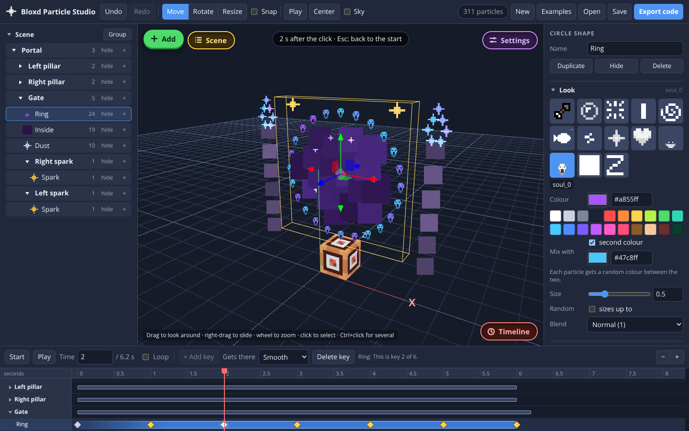

# Bloxd Particle Studio

Build particle pictures for [Bloxd](https://bloxd.io) in a 3D view, then export
the code for a code block. Place single particles or ready-made shapes made of
many particles, pick a texture and a colour, and paste the result into your
world.



This is an unofficial fan tool. It is not made, approved or supported by Bloxd.

## Open it

Pick whichever is easiest:

- **Use it online:** <https://epicoo00000.github.io/Bloxd-Particle-studio/>
- **Double-click `START-HERE.html`.** It is the whole studio in one file and
  works offline.
- **Run it locally:** `npm start`, then open <http://localhost:8080>.
- **Host your own copy:** upload the folder to any static host. `index.html` is
  the start page. On GitHub Pages, choose "Deploy from a branch", `main` and
  `/ (root)`, and leave "Custom domain" empty.

It needs a current browser with WebGL 2, which all current desktop browsers
have. It was tested in Chromium, the engine of Chrome and Edge.

## Make something

1. **Add** a single particle or one of the 24 shapes from the left panel.
2. **Click** it in the 3D view. Drag the arrows to move it. Switch to Rotate or
   Resize in the top bar.
3. **Style** it on the right: texture, colour, size, how many particles.
4. Press **Play** to preview movement and fading.
5. Press **Export code**.

The crate in the middle is your code block. One grid square is one block, and
everything shows up in the game where you see it around the crate.

Your scene is kept in the browser between visits. **Save** writes it to a file
and **Open** loads one, so you can keep several scenes or share them.

### Shapes

Line, Circle, Disc, Arc, Square, Filled square, Triangle, Polygon, Star, Heart,
Plus, Rays, Spiral, Wave, Sphere, Dome, Cube, Filled cube, Cylinder, Cone,
Pyramid, Donut, Helix, Tornado.

Every shape has a "How many" slider for the number of particles. Some have
settings of their own, such as the number of points on a star or the turns of
a helix.

### Keys

| Key | Does |
|---|---|
| W, E, R | Move, Rotate, Resize |
| Ctrl+D | Duplicate |
| Delete or Backspace | Delete |
| Ctrl+Z, Ctrl+Shift+Z (or Ctrl+Y) | Undo, Redo |
| F | Center the view |
| Space | Play or stop |
| Escape | Stop playing, deselect, or close the export window |

Mouse: drag to look around, right-drag to slide, wheel to zoom.

## Put it in your world

1. In Bloxd, place a **Code Block** (search for it in the creative menu).
2. Right-click it, paste the exported code and close the editor.
3. Click the block. The particles appear around it.

The particles stay for their lifetime and then vanish. Click again to show them
again.

**Big scenes.** A code block holds 16,000 characters and 500 lines. When a
scene needs more, the studio splits the code into several parts and shows a tab
for each. Stack that many code blocks on top of each other and paste part 1
into the bottom block, part 2 into the next one up, and so on. Code blocks that
touch run together, so click one in the middle of the stack. If part of the
scene is missing, click the other blocks too.

**World Code.** Choose "World Code" in the export window to get a version that
redraws the scene on a timer instead of waiting for a click. Type the world
position where the studio's crate should be, then paste the code into World
Code (F8). If your World Code already has a `tick` callback, merge the two by
hand, because a world can only have one.

**Export options**

| Option | Meaning |
|---|---|
| Positions | How finely positions are stored. 0.01 block is exact. 0.05 and 0.1 give shorter code. |
| Hide beyond | Players further away than this many blocks do not see the particles. 0 means always shown. |

## What the settings mean

| Setting | Meaning |
|---|---|
| Texture | One of the 13 particle pictures the game offers. |
| Colour | Tints the picture. "Second colour" gives every particle a random mix of the two. |
| Size | Particle size in blocks. "Sizes up to" makes them vary. |
| Lifetime | How long the particles stay. The studio shows the time in seconds. |
| Fade out | The particles fade away over the last fifth of their lifetime. |
| Blend | How particles mix with what is behind them. Normal is the usual choice. Glow adds light. |
| Move | Speed along X, Y and Z. With Move Y = 1 and Lifetime 6, the particles rise 6 blocks before they vanish. |
| Scatter | Adds a random extra speed to each particle, in any direction. |
| Grow | Shapes only. Particles fly away from the middle of the shape, or towards it below 0. |
| Gravity | Below 0 the particles fall, above 0 they float up, faster and faster. |

## Good to know

- **Not tested inside Bloxd.** The exported code is checked by automated tests
  against the documented API and against how the game's own code reads its
  options. It has not been run in the game from here. If something looks
  different in your world, the game is right and the studio is wrong.
- **The preview is an estimate.** Timing, movement and blend modes are copied
  from how the game's code works, not measured in the game. In particular, the
  seconds shown for a lifetime assume the game's usual particle speed.
- **Many particles cost speed.** The code makes one particle effect per
  particle. A few hundred is a sensible size. The studio warns above 600, and
  very large scenes may lag or be cut short by the game's limit on how long a
  script may run.
- **Stacked code blocks.** The game's documentation says touching code blocks
  run together but not how far that reaches along a stack, so a tall stack may
  need more than one click.
- **One preview picture is a stand-in.** The real picture for
  `fishingFishSilhouette` could not be obtained, so the studio shows its own
  drawing of a fish, marked `~`. The game still shows the real one. See
  [textures/README.md](textures/README.md).

## For developers

No build step is needed to run it: plain HTML, CSS and ES modules, with
three.js included in `vendor/`.

```
npm start        # serve the folder on http://localhost:8080
npm test         # unit tests
npm install      # once, before the next command
npm run build    # rebuild START-HERE.html
```

`START-HERE.html` is built from the other files. After changing anything in
`index.html`, `js/`, `css/`, `vendor/` or `textures/`, run `npm run build`;
`npm test` fails while the file is out of date.

| Path | What it is |
|---|---|
| `index.html`, `css/style.css` | The page and its looks |
| `js/shapes.js` | The 24 shapes: each returns a list of points |
| `js/scene.js` | Scene data, checks for loaded files, the preview maths |
| `js/codegen.js` | Turns a scene into Bloxd code, split to fit code blocks |
| `js/viewport.js` | The 3D view (three.js) |
| `js/app.js` | Buttons, panels, undo, saving, the export window |
| `tests/core.test.mjs` | Tests. They run the exported code against a stand-in for the game's `api` |
| `tools/` | Local server and the single-file build |
| `textures/` | Particle pictures used for the preview |

## Credits and licence

- Code: Apache License 2.0, see [LICENSE](LICENSE).
- [three.js](https://threejs.org) 0.170: MIT, see `vendor/LICENSE-three.txt`.
- Particle pictures and the code block picture: Bloxd artwork, not covered by
  the licence above. Where each file came from is listed in
  [textures/README.md](textures/README.md).
- The Bloxd Code API is documented at <https://bloxd.io/docs>.
